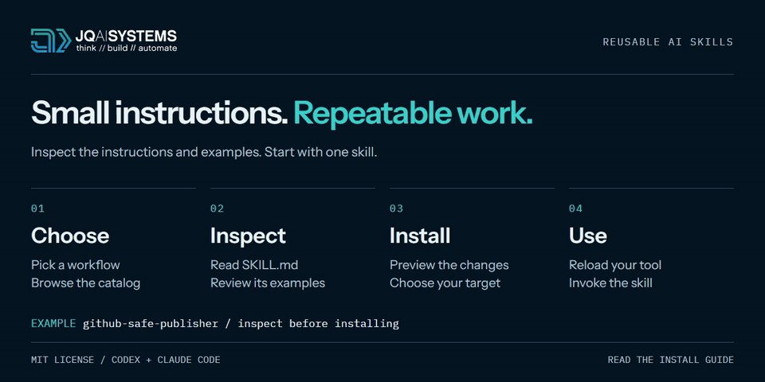
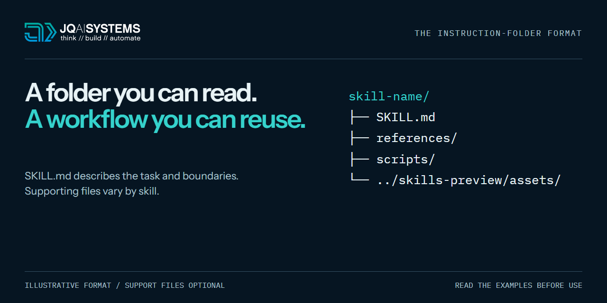

# JQ AI Skills

Portable instruction folders for repeatable work with Codex and Claude Code. Read the instructions, inspect the examples, and start with one workflow.

[Start here](START_HERE.md) · [Browse the catalog](docs/catalog.md) · [Install safely](INSTALL.md) · [Inspect the proof](docs/examples/public-proof-index.md)

[](https://github.com/jqaisystems/jqai-ai-skills/releases/latest)
[](LICENSE)
[](https://github.com/jqaisystems/jqai-ai-skills/actions/workflows/validate.yml)

The [v0.13.0 release](docs/announcements/v0.13.0.md), published on 14 October 2026, contains 47 skills. It adds [backup-readiness-auditor](skills/backup-readiness-auditor/SKILL.md), safer installation and updated setup guidance. Check the [latest release](https://github.com/jqaisystems/jqai-ai-skills/releases/latest) for subsequent changes.

Installation requires Python 3.11+. New Codex setups should explicitly choose the supported discovery target; read [safe installation and discovery](docs/guides/safe-installation.md) before copying or upgrading skills.

<a href="START_HERE.md"><picture><source media="(prefers-reduced-motion: reduce)" srcset="assets/jq-ai-skills-launch-poster.png"></picture></a>

[Static preview](assets/jq-ai-skills-launch-poster.png) · [Watch the 16-second silent overview](assets/jq-ai-skills-launch-video-with-music.mp4)

This animation explains the workflow. Use the install guide for current commands and prerequisites.

[Requirements and installation](INSTALL.md) · [Support](SUPPORT.md) · [Contributing](CONTRIBUTING.md)

## Pick your route

| You want to… | Start with |
|---|---|
| Understand the library | [Start Here](START_HERE.md) and the [visitor paths](docs/examples/visitor-paths.md) |
| Try one useful skill | [First-skill scorecard](docs/guides/first-skill-scorecard.md) and [walkthrough](docs/examples/first-skill-walkthrough.md) |
| Check the quality and boundaries | [Evaluation guide](docs/guides/evaluate-skill-library.md) and [public proof index](docs/examples/public-proof-index.md) |
| Install or update | [Installation](INSTALL.md) and [verification](docs/guides/install-verification.md) |

<details>
<summary>What is inside a skill folder?</summary>



SKILL.md defines the workflow. Supporting folders vary by skill. Read the instructions and public examples before use.

</details>

## Quick Start

If you are new here, start with one skill rather than installing everything:

| If your job is... | Install first | Why |
|---|---|---|
| Public-release safety review | [`github-safe-publisher`](skills/github-safe-publisher/SKILL.md) | Checks sensitive project material before public release. |
| Turning work into public proof | [`case-study-writer`](skills/case-study-writer/SKILL.md) | Converts private project context into a public-safe case study shape. |
| Announcing shipped work | [`release-announcement-writer`](skills/release-announcement-writer/SKILL.md) | Turns changelogs and diffs into release notes, website blurbs, and launch posts. |
| Reviewing third-party skills | [`skill-reviewer`](skills/skill-reviewer/SKILL.md) | Audits skill instructions before you install them locally. |

For first-use help, use [`START_HERE.md`](START_HERE.md), [`QUICK_REFERENCE.md`](QUICK_REFERENCE.md), or the route picker in [`docs/examples/visitor-paths.md`](docs/examples/visitor-paths.md). For install details, use [`INSTALL.md`](INSTALL.md), [`docs/guides/one-minute-install.md`](docs/guides/one-minute-install.md), and [`docs/guides/install-verification.md`](docs/guides/install-verification.md).

Install flow:

1. Pick a skill folder from `skills/`.
2. Read the installation guide, choose your target and preview the planned changes before installing.
3. Restart or reload your AI coding tool.
4. Invoke the skill by name in your prompt.

<details>
<summary>Example prompts for the workflows</summary>

```text
Use $github-safe-publisher to prepare this repo for a public release.
Use $case-study-writer to turn this private project summary into a public-safe case study.
Use $outreach-pipeline-designer to design a safe human-reviewed prospecting workflow.
Use $cold-outreach-writer to draft a cold email for this prospect from my research notes.
Use $lead-scorer to score this lead list against my rubric and rank it.
Use $etsy-listing-optimizer to audit and rewrite a marketplace listing safely.
Use $research-brief-curator to turn public links into a safe weekly research brief.
Use $verify-public-claims to check this public copy against the supplied evidence and flag unsupported claims.
Use $research-to-article to turn these sources into a traceable, publication-ready article package.
Use $write-evidence-backed-profile to draft this profile copy from the approved evidence pack.
Use $release-announcement-writer to turn this changelog into release notes and a launch post.
Use $github-profile-proof-updater to refresh my GitHub profile assets and prepare the proof trail.
Use $social-campaign-proof-tracker to turn this project update into LinkedIn/X copy, alt text, and follow-up notes.
Use $skill-reviewer to audit this downloaded skill before installing it.
Use $em-dash-remover to clean this landing page copy.
Use $code-deduplicator to consolidate repeated formatting helpers in this sample.
Use $brand-voice-linter to check this copy against our voice guide.
Use $php-form-mailer to make this contact form send email without a third-party service.
Use $client-intake-builder to create a branded intake questionnaire for this project.
Use $llms-txt-generator to create an llms.txt for this site.
Use $vault-janitor to scan this folder and report what is safe to clean.
Use $obsidian-daily-note to log this to today's daily note.
Use $idea-inbox to capture this idea into my ideas folder.
Use $demo-animation-v2 to create a responsive animated walkthrough.
Use $proposal-writer to draft a proposal for this client from my pricing config and their brief.
Use $follow-up-radar to scan my outreach folder and show me what follow-ups are overdue.
Use $client-workspace-scaffolder to set up a folder for my new client.
Use $discovery-brief to run discovery for this client project.
Use $implement-client-feedback to turn these revision notes into scoped changes and verify every item.
Use $client-delivery-auditor to audit this final package and draft a clear handoff.
Use $website-change-verifier to verify this website change across routes, rendering, metadata, and discovery surfaces.
Use $skill-builder to turn the workflow we just did into a reusable skill.
Use $session-handoff to wrap up this session into a START_HERE.md.
Use $agents-md-writer to register my local skills for both Claude Code and Codex.
Use $ops-status-report to generate this week's status snapshot of my workspace.
Use $screen-recorder to record a region of my screen.
Use $remove-ai-image-metadata to inspect these images, create verified clean copies, and report which explicit AI provenance metadata was removed.
```

</details>

## Example Artifacts

Every skill ships with public-safe proof: fake-data samples, guides, and checklists a visitor can inspect before installing anything. The short list below covers the main entry points; everything else is one click away.

- [`docs/examples/README.md`](docs/examples/README.md) is the full index of public-safe samples, walkthroughs, workflow bundles, and first-run outputs.
- [`docs/examples/public-proof-index.md`](docs/examples/public-proof-index.md) gathers the install, safety, sample, system, and visual proof assets in one place.
- [`docs/catalog.md`](docs/catalog.md) is the complete catalog of all installable skills, recommended bundles, and safe install defaults.
- [`docs/skill-quality-matrix.md`](docs/skill-quality-matrix.md) compares skill maturity, visible proof, safety sensitivity, and safest install notes.
- [`INSTALL.md`](INSTALL.md), [`TROUBLESHOOTING.md`](TROUBLESHOOTING.md), and the guides in [`docs/guides/`](docs/guides/) cover install, verification, update, review, and first-skill selection routines.
- [`CHANGELOG.md`](CHANGELOG.md), [`RELEASE_CHECKLIST.md`](RELEASE_CHECKLIST.md), [`SECURITY.md`](SECURITY.md), [`ROADMAP.md`](ROADMAP.md), and [`SUPPORT.md`](SUPPORT.md) document how this repo is maintained and released.

## Skill catalog

[Browse the complete catalog](docs/catalog.md) or expand the category index below.

<details>
<summary>Browse the skills by category</summary>

### Safety & Publishing

| Skill | File | Use |
|---|---|---|
| GitHub Safe Publisher | [`skills/github-safe-publisher/SKILL.md`](skills/github-safe-publisher/SKILL.md) | Prepare private work for public GitHub releases safely. |
| Skill Reviewer | [`skills/skill-reviewer/SKILL.md`](skills/skill-reviewer/SKILL.md) | Review AI skill files or folders for dangerous behavior. |
| Local App to Public Demo | [`skills/local-app-public-demo/SKILL.md`](skills/local-app-public-demo/SKILL.md) | Freeze a local app into a static read-only public demo from the same codebase, with machine paths and private data verified gone. |

### Public Proof

| Skill | File | Use |
|---|---|---|
| Case Study Writer | [`skills/case-study-writer/SKILL.md`](skills/case-study-writer/SKILL.md) | Turn private project work into public-safe case studies. |
| Release Announcement Writer | [`skills/release-announcement-writer/SKILL.md`](skills/release-announcement-writer/SKILL.md) | Turn changelogs and shipped changes into release notes, website blurbs, and launch posts. |
| GitHub Profile Proof Updater | [`skills/github-profile-proof-updater/SKILL.md`](skills/github-profile-proof-updater/SKILL.md) | Refresh GitHub profile visuals, preserve README paths, verify live rendering, and document proof trails. |
| Social Campaign Proof Tracker | [`skills/social-campaign-proof-tracker/SKILL.md`](skills/social-campaign-proof-tracker/SKILL.md) | Plan LinkedIn/X proof campaigns, alt text, published links, reply banks, and follow-up windows. |

### Growth & Outreach

| Skill | File | Use |
|---|---|---|
| Outreach Pipeline Designer | [`skills/outreach-pipeline-designer/SKILL.md`](skills/outreach-pipeline-designer/SKILL.md) | Design safe human-reviewed prospecting and outreach workflows. |
| Cold Outreach Writer | [`skills/cold-outreach-writer/SKILL.md`](skills/cold-outreach-writer/SKILL.md) | Draft a personalised cold email, subject lines, LinkedIn note, and follow-up from research notes. |
| Lead Scorer | [`skills/lead-scorer/SKILL.md`](skills/lead-scorer/SKILL.md) | Rank a lead list into hot, warm, and cold tiers against your own rubric. |
| Follow-up Radar | [`skills/follow-up-radar/SKILL.md`](skills/follow-up-radar/SKILL.md) | Find overdue outreach follow-ups in a folder of markdown and draft them, oldest first. |
| Etsy Listing Optimizer | [`skills/etsy-listing-optimizer/SKILL.md`](skills/etsy-listing-optimizer/SKILL.md) | Audit, rewrite, batch, and monitor marketplace listings. |

### Client Work

| Skill | File | Use |
|---|---|---|
| Client Workspace Scaffolder | [`skills/client-workspace-scaffolder/SKILL.md`](skills/client-workspace-scaffolder/SKILL.md) | Scaffold a client project folder from your reusable structure template. |
| Discovery Brief | [`skills/discovery-brief/SKILL.md`](skills/discovery-brief/SKILL.md) | Run a discovery interview and write the brief plus a strategy starter. |
| Proposal Writer | [`skills/proposal-writer/SKILL.md`](skills/proposal-writer/SKILL.md) | Draft a client proposal from your own service tiers and terms. |
| Implement Client Feedback | [`skills/implement-client-feedback/SKILL.md`](skills/implement-client-feedback/SKILL.md) | Convert revision notes into scoped changes, protected exclusions, and verified results. |
| Client Delivery Auditor | [`skills/client-delivery-auditor/SKILL.md`](skills/client-delivery-auditor/SKILL.md) | Audit promised deliverables and prepare a clear handoff plus an unsent delivery message. |
| Website Change Verifier | [`skills/website-change-verifier/SKILL.md`](skills/website-change-verifier/SKILL.md) | Verify website changes across routes, rendering, metadata, discovery surfaces, and deployment state. |

### Content & Research

| Skill | File | Use |
|---|---|---|
| Research Brief Curator | [`skills/research-brief-curator/SKILL.md`](skills/research-brief-curator/SKILL.md) | Turn public links and notes into source-aware research briefs with review gates. |
| Verify Public Claims | [`skills/verify-public-claims/SKILL.md`](skills/verify-public-claims/SKILL.md) | Classify public claims against current evidence and produce defensible rewrites. |
| Research to Article | [`skills/research-to-article/SKILL.md`](skills/research-to-article/SKILL.md) | Turn sources into a claim map, finished article, metadata, Link Map, and verification notes. |
| Write Evidence-Backed Profile | [`skills/write-evidence-backed-profile/SKILL.md`](skills/write-evidence-backed-profile/SKILL.md) | Draft bios, applications, and profile copy from approved evidence without invented claims. |
| llms.txt Generator | [`skills/llms-txt-generator/SKILL.md`](skills/llms-txt-generator/SKILL.md) | Generate a spec-compliant llms.txt map of a website for AI assistants. |
| Web Scraper | [`skills/web-scraper/SKILL.md`](skills/web-scraper/SKILL.md) | Extract public page content safely into structured notes. |
| Em Dash Remover | [`skills/em-dash-remover/SKILL.md`](skills/em-dash-remover/SKILL.md) | Clean one common AI-writing tell from copy. |
| Brand Voice Linter | [`skills/brand-voice-linter/SKILL.md`](skills/brand-voice-linter/SKILL.md) | Lint copy against a brand voice guide: buzzwords, hedging, superlatives, AI tells. |

### Dev Workflow

| Skill | File | Use |
|---|---|---|
| Code Deduplicator | [`skills/code-deduplicator/SKILL.md`](skills/code-deduplicator/SKILL.md) | Safely consolidate repeated code patterns. |
| PHP Form Mailer | [`skills/php-form-mailer/SKILL.md`](skills/php-form-mailer/SKILL.md) | Wire any HTML form to a two-email PHP handler with no form SaaS. |
| Client Intake Builder | [`skills/client-intake-builder/SKILL.md`](skills/client-intake-builder/SKILL.md) | Generate a branded single-file client intake questionnaire. |
| Vault Janitor | [`skills/vault-janitor/SKILL.md`](skills/vault-janitor/SKILL.md) | Find folder junk and report it with sizes; deletes only what you approve. |

### Media & Provenance

| Skill | File | Use |
|---|---|---|
| Media Spec Checker | [`skills/media-spec-checker/SKILL.md`](skills/media-spec-checker/SKILL.md) | Read-only local image/video checks against supplied, versioned rules; unknown measurements never pass. |
| Remove AI Image Metadata | [`skills/remove-ai-image-metadata/SKILL.md`](skills/remove-ai-image-metadata/SKILL.md) | Inspect and remove explicit AI-generator or provenance metadata from authorized image files while preserving encoded picture data when the format permits. |
| AI Image Run Pacing | [`skills/ai-image-run-pacing/SKILL.md`](skills/ai-image-run-pacing/SKILL.md) | Run a batch of AI image generations without getting rate limited, losing subject likeness, or storing credentials. |
| Thumbnail Set Designer | [`skills/thumbnail-set-designer/SKILL.md`](skills/thumbnail-set-designer/SKILL.md) | Turn a title and hook into a set of genuinely different on-brand thumbnail prompts, with the traps that ruin AI thumbnails built in. |
| Thumbnail Legibility Check | [`skills/thumbnail-legibility-check/SKILL.md`](skills/thumbnail-legibility-check/SKILL.md) | Judge thumbnail candidates at the size viewers actually see them, then rank them through pairwise duels. |

### Local Workflow Utilities

| Skill | File | Use |
|---|---|---|
| Automation State Reconciler | [`automation-state-reconciler`](skills/automation-state-reconciler/SKILL.md) | Compare offline snapshots and receipts; preserve history and draft a human-reviewed repair plan without executing it. |
| Windows Reinstall Planner | [`windows-reinstall-planner`](skills/windows-reinstall-planner/SKILL.md) | Collect software registration metadata and prepare a private reinstall checklist, without installing or removing software. |

### Notes & Productivity

| Skill | File | Use |
|---|---|---|
| Obsidian Daily Note | [`skills/obsidian-daily-note/SKILL.md`](skills/obsidian-daily-note/SKILL.md) | Append to today's Obsidian daily note from the terminal. |
| Idea Inbox | [`skills/idea-inbox/SKILL.md`](skills/idea-inbox/SKILL.md) | Capture raw ideas as dated, tagged, indexed markdown files. |
| Ops Status Report | [`skills/ops-status-report/SKILL.md`](skills/ops-status-report/SKILL.md) | Compile a workspace status snapshot with an Attention Needed section. |

### Agent Workflow

| Skill | File | Use |
|---|---|---|
| Skill Builder | [`skills/skill-builder/SKILL.md`](skills/skill-builder/SKILL.md) | Author a scoped skill with current discovery guidance, safe installation boundaries, and fictional tests. |
| Session Handoff | [`skills/session-handoff/SKILL.md`](skills/session-handoff/SKILL.md) | Freeze session state into a start-here doc for instant resume. |
| AGENTS.md Writer | [`skills/agents-md-writer/SKILL.md`](skills/agents-md-writer/SKILL.md) | Generate the AGENTS.md and CLAUDE.md contract that shares skills across agents. |

### Demo & Presentation

| Skill | File | Use |
|---|---|---|
| Demo Animation | [`skills/demo-animation/SKILL.md`](skills/demo-animation/SKILL.md) | Build legacy desktop-oriented product/demo walkthroughs. |
| Demo Animation V2 | [`skills/demo-animation-v2/SKILL.md`](skills/demo-animation-v2/SKILL.md) | Build recommended responsive demo walkthroughs. Includes [`assets/template.html`](skills/demo-animation-v2/assets/template.html). |
| Screen Recorder | [`skills/screen-recorder/SKILL.md`](skills/screen-recorder/SKILL.md) | Record a drag-selected region of the Windows desktop to a clean MP4 (FFmpeg). |

</details>

<details>
<summary>Match a task to a skill</summary>

For the fastest guided install, see [`docs/guides/one-minute-install.md`](docs/guides/one-minute-install.md). To score the safest first install, see [`docs/guides/first-skill-scorecard.md`](docs/guides/first-skill-scorecard.md). To prove the full first-install path, see [`docs/examples/first-install-proof.md`](docs/examples/first-install-proof.md). To run the selected skill with fake input, see [`docs/examples/first-skill-walkthrough.md`](docs/examples/first-skill-walkthrough.md), the [`first-skill candidate pack`](docs/examples/first-skill-candidate/README.md), and its [`expected review`](docs/examples/first-skill-candidate/expected-review.md). For the detailed visitor guide, see [`docs/guides/skill-selection.md`](docs/guides/skill-selection.md). To understand the folder contract, see [`docs/guides/skill-anatomy.md`](docs/guides/skill-anatomy.md). To review an unfamiliar skill before install, see [`docs/guides/skill-review-checklist.md`](docs/guides/skill-review-checklist.md). For the complete catalog, see [`docs/catalog.md`](docs/catalog.md).

| If you want to... | Start with |
|---|---|
| Publish private work without leaking secrets | [`github-safe-publisher`](skills/github-safe-publisher/SKILL.md) |
| Turn internal work into client-readable proof | [`case-study-writer`](skills/case-study-writer/SKILL.md) |
| Design a review-first sales or prospecting workflow | [`outreach-pipeline-designer`](skills/outreach-pipeline-designer/SKILL.md) |
| Draft a personalised cold email from research notes | [`cold-outreach-writer`](skills/cold-outreach-writer/SKILL.md) |
| Decide which leads to contact first | [`lead-scorer`](skills/lead-scorer/SKILL.md) |
| Improve a marketplace listing safely | [`etsy-listing-optimizer`](skills/etsy-listing-optimizer/SKILL.md) |
| Turn public links into a reviewed research brief | [`research-brief-curator`](skills/research-brief-curator/SKILL.md) |
| Check whether public claims match the evidence | [`verify-public-claims`](skills/verify-public-claims/SKILL.md) |
| Turn verified sources into a finished article package | [`research-to-article`](skills/research-to-article/SKILL.md) |
| Write a bio or application from approved evidence | [`write-evidence-backed-profile`](skills/write-evidence-backed-profile/SKILL.md) |
| Package release notes or a launch post | [`release-announcement-writer`](skills/release-announcement-writer/SKILL.md) |
| Refresh a GitHub profile as a public proof layer | [`github-profile-proof-updater`](skills/github-profile-proof-updater/SKILL.md) |
| Track a LinkedIn/X proof campaign after publishing | [`social-campaign-proof-tracker`](skills/social-campaign-proof-tracker/SKILL.md) |
| Review a downloaded skill before installing it | [`skill-reviewer`](skills/skill-reviewer/SKILL.md) |
| Extract structured data from public pages | [`web-scraper`](skills/web-scraper/SKILL.md) |
| Clean AI-ish punctuation from copy | [`em-dash-remover`](skills/em-dash-remover/SKILL.md) |
| Enforce a full brand voice guide on copy | [`brand-voice-linter`](skills/brand-voice-linter/SKILL.md) |
| Reduce repeated code patterns | [`code-deduplicator`](skills/code-deduplicator/SKILL.md) |
| Make a static-site form send email without a service | [`php-form-mailer`](skills/php-form-mailer/SKILL.md) |
| Onboard clients with a branded questionnaire | [`client-intake-builder`](skills/client-intake-builder/SKILL.md) |
| Make a website readable and citable by AI assistants | [`llms-txt-generator`](skills/llms-txt-generator/SKILL.md) |
| Find out what is eating a folder's disk space | [`vault-janitor`](skills/vault-janitor/SKILL.md) |
| Log work and thoughts to an Obsidian daily note | [`obsidian-daily-note`](skills/obsidian-daily-note/SKILL.md) |
| Capture ideas without losing them in the repo root | [`idea-inbox`](skills/idea-inbox/SKILL.md) |
| Build a responsive walkthrough demo | [`demo-animation-v2`](skills/demo-animation-v2/SKILL.md) |
| Build a legacy desktop-only walkthrough demo | [`demo-animation`](skills/demo-animation/SKILL.md) |
| Draft a client proposal from your own price tiers | [`proposal-writer`](skills/proposal-writer/SKILL.md) |
| Find and draft the follow-ups you forgot | [`follow-up-radar`](skills/follow-up-radar/SKILL.md) |
| Set up a new client folder in seconds | [`client-workspace-scaffolder`](skills/client-workspace-scaffolder/SKILL.md) |
| Run project discovery and write the brief | [`discovery-brief`](skills/discovery-brief/SKILL.md) |
| Turn revision notes into scoped, verified changes | [`implement-client-feedback`](skills/implement-client-feedback/SKILL.md) |
| Audit a final delivery package before sending | [`client-delivery-auditor`](skills/client-delivery-auditor/SKILL.md) |
| Verify a website change across every affected surface | [`website-change-verifier`](skills/website-change-verifier/SKILL.md) |
| Turn a workflow into a reusable skill | [`skill-builder`](skills/skill-builder/SKILL.md) |
| Resume tomorrow where you stopped today | [`session-handoff`](skills/session-handoff/SKILL.md) |
| Share one skill set between Claude Code and Codex | [`agents-md-writer`](skills/agents-md-writer/SKILL.md) |
| Get a weekly status snapshot of a workspace | [`ops-status-report`](skills/ops-status-report/SKILL.md) |
| Record a region of the Windows desktop to MP4 | [`screen-recorder`](skills/screen-recorder/SKILL.md) |

</details>

## Why This Matters

The skills repo is the technical credibility layer behind the client-facing systems. It shows how JQ AI SYSTEMS packages repeatable AI workflows into reusable instructions, review steps, and safety checks instead of relying on one-off prompts.

## Installation

Requires Python 3.11+. Review [INSTALL.md](INSTALL.md) and [safe installation and discovery](docs/guides/safe-installation.md) first. Choose a verified target and use a dry run before writing files. New Codex setups use ~/.agents/skills; Claude Code uses ~/.claude/skills.

From the repository root, preview one Codex skill:

Windows PowerShell:

```powershell
.\install.ps1 github-safe-publisher -Target "$HOME\.agents\skills" -DryRun
```

macOS/Linux:

```bash
bash ./install.sh --target "$HOME/.agents/skills" --dry-run github-safe-publisher
```

Inspect the plan, then repeat the command without the dry-run flag to install. Reload your tool and verify discovery with the [installation checks](docs/guides/install-verification.md).

The installer retains a legacy default for compatibility. These examples choose the target explicitly. Do not merge or force-copy into an existing skill; follow the guide for managed upgrades and manual-install migration.

[List commands and prerequisites](INSTALL.md) · [First-skill walkthrough](docs/examples/first-skill-walkthrough.md) · [Troubleshooting](TROUBLESHOOTING.md)

## Contributing

Use [`CONTRIBUTING.md`](CONTRIBUTING.md) for the expected folder format, metadata requirements, safety rules, and pre-submission checklist. For a public-safe proposal shape, use [`docs/examples/skill-request-example.md`](docs/examples/skill-request-example.md).

## Safety Notes

- These files are instructions, not secrets.
- Do not paste sensitive keys, sign-in material, customer records, account exports, or unreleased project notes into prompts unless you fully understand where they will go.
- Use [`SECURITY.md`](SECURITY.md) for responsible-use rules and sensitive issue reporting.
- The `skill-reviewer` skill exists to help inspect third-party skill files before installing them.
- Use [`docs/guides/skill-review-checklist.md`](docs/guides/skill-review-checklist.md) before installing unfamiliar or modified skill folders.
- Run new skills on a test folder before using them in production work.

## License

Released under the [MIT License](LICENSE).

More systems and case studies: [ai.joaoqueiros.com/systems](https://www.ai.joaoqueiros.com/systems)

Want a custom workflow built around your team? Start here: [ai.joaoqueiros.com/contact](https://www.ai.joaoqueiros.com/contact)
